<picture>
  <source media="(prefers-color-scheme: dark)" srcset="https://raw.githubusercontent.com/RexJonas333/RexJonas333/output/gipfel-night.svg">
  
</picture>

### Hi, ich bin Jonas

Mein Contribution-Jahr als Bergpanorama – erzeugt mit [gipfel](https://github.com/RexJonas333/gipfel).
